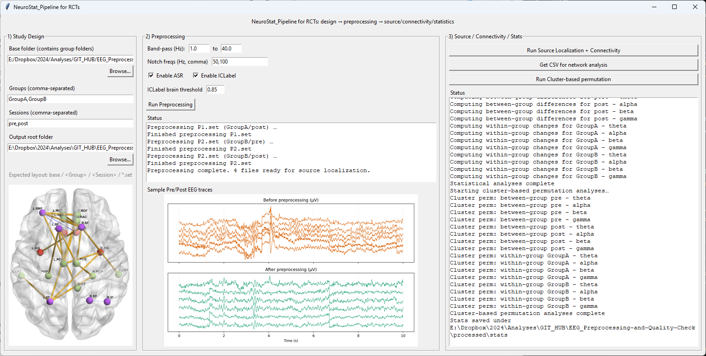

# NeuroStat_Pipeline for RCTs

End-to-end EEG pipeline with a modern PyQt5 GUI featuring:
- Study design selection by groups/sessions
- Preprocessing with ASR and ICA+ICLabel (auto artifact removal)
- Source localization on fsaverage, Desikan–Killiany label time courses
- PLI connectivity per band, CSV + figures
- Network table export to Excel
- Cluster-based permutation statistics and classic edge-wise tests
- Modern dark theme with non-blocking UI during processing

Run the GUI: `python run_study_app.py`

### MAIN GUI

## Quick Start

- Python 3.9+
- Recommended packages:
  - Core: `mne`, `numpy`, `scipy`, `pandas`, `matplotlib`, `openpyxl`
  - Connectivity: `mne-connectivity` (or MNE 1.3+ with `mne.connectivity`)
  - GUI: `PyQt5` (modern dark-themed interface)
  - Optional speedups: `cupy` (GPU)
  - Optional preprocessing: `mne-icalabel` (ICLabel), `asrpy` or `mne-asr` (ASR)

Install example:
- `pip install mne numpy scipy pandas matplotlib openpyxl mne-connectivity PyQt5`
- Optional: `pip install mne-icalabel asrpy` (or `pip install mne-asr`)
- Optional (GPU): `pip install cupy-cuda12x` (match your CUDA version)

Launch the app:
- `python run_study_app.py`

## Expected Folder Layout

Your raw EEGLAB recordings must be arranged as:
- `base_folder/GroupA/Session1/*.set`
- `base_folder/GroupB/Session1/*.set`
- `base_folder/GroupA/Session2/*.set`

You choose the base folder and comma-separated group/session names in the GUI.

## GUI Overview

The application features a modern PyQt5 interface with a dark theme (Catppuccin-inspired colors) and threaded execution for responsive UI during long-running operations.

Column 1 — Study Design
- Pick base folder (contains group folders)
- Enter `Groups` and `Sessions` (comma-separated)
- Choose `Output root` for generated files
- Brain image scales with window size for a clear visual anchor

Column 2 — Preprocessing
- Set `Band-pass` (low/high) and `Notch` frequencies
- Enable optional `ASR` denoising
- Enable `ICLabel` with `Brain threshold` (default 0.85)
- Click `Run Preprocessing`
- See live status and a large "before/after EEG traces" preview
- UI remains responsive during processing with real-time log updates

Column 3 — Source / Connectivity / Stats
- `Run Source Localization + Connectivity` — computes label time courses and PLI per band
- `Get CSV for network analysis` — aggregates per-band CSVs into a single Excel file
- `Run Cluster-based permutation` — runs edge-wise t-tests and cluster-based permutation using edge adjacency, saves figures and arrays

Run All Panel (Bottom)
- Select which pipeline steps to include: Preprocessing, Source + Connectivity, CSV Export, Statistics
- Click `RUN ALL SELECTED STEPS` to execute the full pipeline sequentially
- Progress bar shows current step and completion status
- Errors are logged and reported at the end without stopping the entire pipeline

Start the app via `run_study_app.py`. The GUI code is in `app_gui.py`; the pipeline code lives in `pli_pipeline.py`.

## Outputs

For each recording (subject), outputs are saved under:
- `output_root/<Group>/<Session>/<SubjectName>/`

Per-subject artifacts and diagnostics
- `preprocessed_raw.fif` — preprocessed MNE Raw
- `traces_before_after.png` — stacked EEG traces (before vs after)
- `topomap_before_after.png` — RMS scalp maps (before/after)
- `gfp_before_after.png` — Global Field Power (before/after)
- `source_power.png` — DK atlas region-wise activity (RMS)

Connectivity per band (Desikan–Killiany labels)
- `<band>_PLI.csv` — connectivity matrix
- `<band>_PLI.png` — heatmap
- `<band>_circle.png` — connectivity circle (if supported by your MNE install)
- `mat files/<Subject>_<Group>_<Band>_PLI.mat` — MATLAB format export

Study-level summary
- `output_root/PLI_Table.xlsx` — rows: Participant, Group, Session, FrequencyTag, MeanPLI, Network

Statistics
- Classic edge-wise Welch t-tests (p<0.05, uncorrected):
  - `output_root/stats/between_groups/<Session>_<Band>/...`
  - `output_root/stats/within_groups/<Group>/<Band>/...`
- Cluster-based permutation on edges (adjacency: edges share a node):
  - `output_root/stats/cluster_perm/between_groups/<Session>_<Band>/...`
  - `output_root/stats/cluster_perm/within_groups/<Group>/<Band>/...`
  - Saves `.npz` arrays (t_matrix, significant_mask, p_values) and `.png` plots

## Figures

The images in this section are illustrative screenshots stored in `FigsREAD/` solely for README documentation. The app does not save outputs there. Actual pipeline figures and files are written under `output_root/<Group>/<Session>/<Subject>/` and stats under `output_root/stats/...` as described above.

- App overview (3-column GUI)
  

- Preprocessing — before/after EEG traces
  

- Connectivity — example circle or heatmap
  

- Excel network table
  

## Notes & Requirements

- fsaverage and trans:
  - The pipeline uses `fsaverage` for source localization. If `fsaverage` is not available locally and your machine is offline, set `PipelineConfig.source.subjects_dir` to a local FreeSurfer subjects directory containing `fsaverage`.
  - Provide a valid head↔MRI transform in `PipelineConfig.source.trans_path` (e.g., `fsaverage-trans.fif`).

- GPU (optional):
  - If CuPy is detected and enabled, PLI can run on GPU for speed. Otherwise it falls back to CPU.

- ICLabel and ASR (optional):
  - ICLabel: `pip install mne-icalabel` (components not labeled as "brain" are rejected as artifacts)
  - The pipeline uses extended infomax ICA for optimal ICLabel compatibility
  - ASR: `pip install asrpy` (artifact subspace reconstruction for continuous data cleaning)

## Troubleshooting

- No stats saved:
  - Make sure you ran “Run Source Localization + Connectivity” first and CSVs exist under `output_root/<Group>/<Session>/<Subject>/*_PLI.csv`.
  - Verify you have at least two subjects per comparison condition.
  - Check the app status messages; if no valid pairs/CSVs are found, the app logs this explicitly.

- fsaverage fetch errors:
  - Provide a local `subjects_dir` with `fsaverage` to avoid downloads.

- Large files / memory:
  - PLI is computed per band on label time courses. If memory is tight, consider fewer/shorter epochs (see `ConnectivityConfig.epoch_length`).

## Development Layout

- GUI: `app_gui.py`
- App launcher: `run_study_app.py`
- Pipeline core: `pli_pipeline.py`
- Original script-based runner (if present): `run_study.py`

Key functions (pipeline stages):
- Preprocessing: `preprocess_file()` and `run_preprocessing_for_design()`
- Source + connectivity: `run_source_loc_and_connectivity()` and `run_source_and_connectivity_for_design()`
- Table aggregation: `aggregate_csv_table()`
- Statistics: `run_stats_for_design()` (classic + cluster-based permutation)

## Citation

If you use this pipeline in publications, please cite MNE-Python and MNE-Connectivity, and any optional components you enable (ICLabel, ASR, CuPy).
