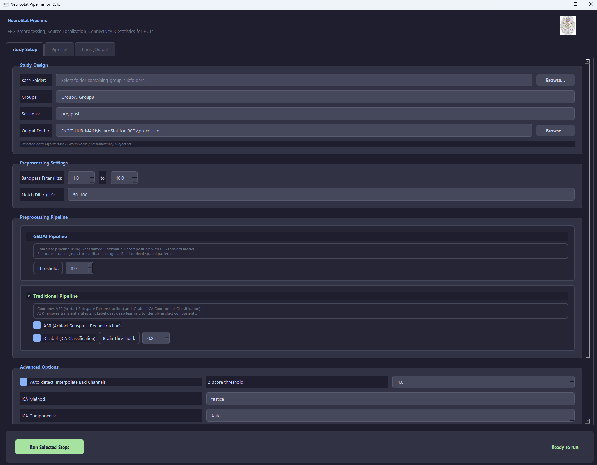
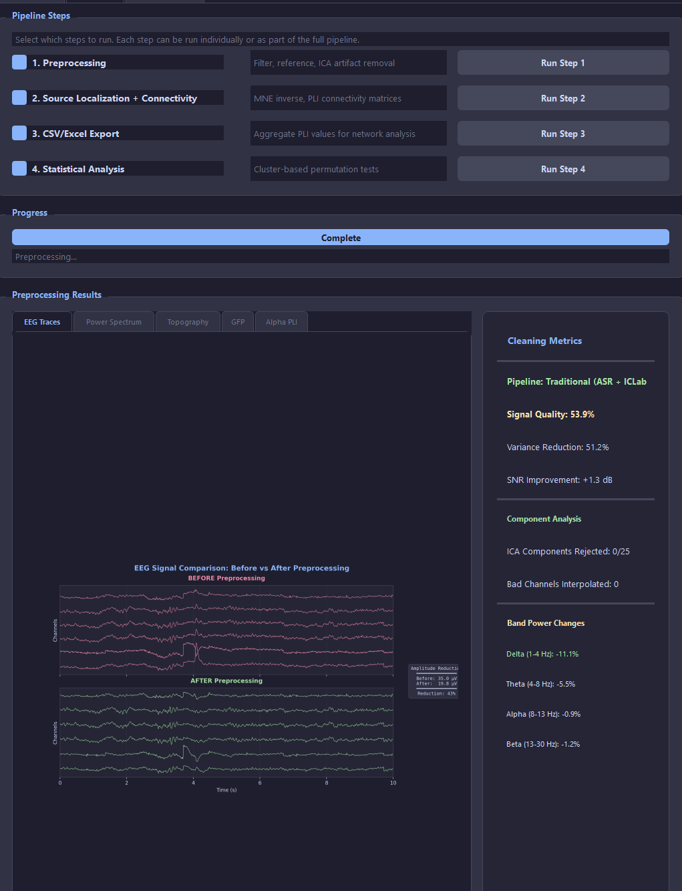

# NeuroStat Pipeline for RCTs

End-to-end EEG processing pipeline for source-localised Phase Lag Index (PLI) connectivity analysis, designed for Randomised Controlled Trials. Features a modern PyQt5 GUI and two preprocessing pathways: **Traditional** (ASR + ICA/ICLabel) and **GEDAI** (Generalised Eigenvalue Decomposition-based Artifact Identification).

### Key Features

- Automated preprocessing with two selectable artifact removal methods
- Source localisation on fsaverage with Desikan-Killiany atlas (68 regions)
- PLI connectivity per band (delta, theta, alpha, beta, gamma) at sensor and source levels
- CSV + Excel export, connectivity circle plots, heatmaps
- Cluster-based permutation statistics and edge-wise tests
- Validated on simulated EEG and PhysioNet public data
- Modern dark-themed GUI with non-blocking processing
- Script runner supports full pipeline mode or preprocessing-only export

Run the GUI: `python run_study_app.py`

### Main GUI


### Some Outputs and Features



## Quick Start

**Requirements:** Python 3.9+

Core dependencies:
```
pip install mne numpy scipy pandas matplotlib openpyxl mne-connectivity PyQt5
```

Optional (recommended):
```
pip install mne-icalabel asrpy gedai
```

Optional (GPU acceleration):
```
pip install cupy-cuda12x
```

Launch: `python run_study_app.py`

### Command-Line Runner

`run_study.py` now supports both full-pipeline execution and a preprocessing-only mode for producing cleaned `.fif` / `.set` outputs without source localisation or PLI:

```bash
python run_study.py E:\path\to\base_folder
python run_study.py E:\path\to\base_folder GroupA,GroupB pre,post processed gedai
python run_study.py E:\path\to\base_folder GroupA,GroupB pre,post processed asr_ica --preprocessing-only
```


## Preprocessing Pathways

NeuroStat provides two artifact removal strategies. Users select the pathway best suited to their data:

| Step | Traditional | GEDAI |
|------|------------|-------|
| Artifact removal | ASR (cutoff=20) + ICA/ICLabel | GEDAI (leadfield-based, noise_multiplier=3.0) |
| Component classification | ICLabel CNN (7-class) | Not used (GEDAI handles spatial filtering) |
| Best for | General-purpose, short recordings | Physics-informed cleaning, standard montages |

Both pathways share: bad channel detection (z > 4.0), FIR bandpass (1-40 Hz), notch filter, average reference, and ICA fitting (FastICA).


## Pipeline Architecture

```
Raw .set file
    |
    v
[Montage assignment] --> auto-detect from 9 standard montages
    |
    v
[Bad channel detection] --> z-score > 4.0, spherical spline interpolation
    |
    +--[GEDAI pathway]--------+--[Traditional pathway]---+
    |  Leadfield-based GED    |  ASR + ICA/ICLabel       |
    +-------------------------+-------------------------+
    |
    v
[Bandpass 1-40 Hz] --> [Notch filter] --> [Average reference]
    |
    v
[ICA fitting] --> FastICA, up to 25 components
    |
    v
[Component rejection] --> ICLabel or EOG/muscle heuristic
    |
    +--[Sensor-level PLI]-----+--[Source-level PLI]------+
    |  Epoch -> multitaper    |  MNE inverse -> 68 DK    |
    |  PLI per band           |  regions -> PLI per band |
    +-------------------------+-------------------------+
    |
    v
[Statistics] --> Welch t-test, cluster permutation (1000 perms)
```


## Validation

The pipeline was validated using two complementary strategies. Full details in [`docs/paper/methods.md`](docs/paper/methods.md) and [`docs/paper/results.md`](docs/paper/results.md).

### Internal: Simulated EEG

Simulated 64-channel EEG with three planted connectivity patterns (alpha, beta, theta) at four artifact severity levels. The Traditional pathway recovered planted PLI values with *r* = .77 (*p* = .004) and MAE = 0.15.

### External: PhysioNet EEGBCI

Replicated the well-established eyes-closed > eyes-open alpha connectivity effect using 20 subjects from the PhysioNet database. Both pathways detected the effect with large effect sizes (Traditional: *d* = 0.83; GEDAI: *d* = 0.89; both *p* < .002).

### Run Validation

```bash
# Full internal validation (simulate + process + analyse)
python scripts/validation/run_complete_validation.py

# External validation (PhysioNet, downloads automatically)
python scripts/validation/physionet_validation.py

# GEDAI vs Traditional comparison on real data
python scripts/validation/physionet_method_comparison.py
```


## Expected Folder Layout

Raw EEGLAB recordings must be arranged as:
```
base_folder/
  GroupA/
    Session1/*.set
    Session2/*.set
  GroupB/
    Session1/*.set
    Session2/*.set
```

You choose the base folder and comma-separated group/session names in the GUI.


## Outputs

For each recording, outputs are saved under `output_root/<Group>/<Session>/<Subject>/`:

**Per-subject:**
- `preprocessed_raw.fif` -- preprocessed MNE Raw
- `traces_before_after.png` -- EEG traces before vs after
- `topomap_before_after.png` -- RMS scalp maps
- `gfp_before_after.png` -- Global Field Power
- `source_power.png` -- DK atlas region activity

**Connectivity per band (Desikan-Killiany):**
- `<band>_PLI.csv` -- connectivity matrix
- `<band>_PLI.png` -- heatmap
- `<band>_circle.png` -- connectivity circle
- `mat files/<Subject>_<Group>_<Band>_PLI.mat` -- MATLAB export

**Study-level:**
- `output_root/PLI_Table.xlsx` -- summary table
- `output_root/stats/` -- between/within group tests and cluster permutation results


## GUI Overview

The application features a modern PyQt5 interface with a dark theme and threaded execution.

- **Column 1 -- Study Design:** Pick base folder, enter groups/sessions, choose output root
- **Column 2 -- Preprocessing:** Set filter parameters, enable ASR/ICLabel/GEDAI, run preprocessing with live preview
- **Column 3 -- Source/Connectivity/Stats:** Source localisation, CSV export, cluster permutation

**Run All Panel:** Select pipeline steps and execute sequentially with progress tracking.


## Development Layout

| File | Purpose |
|------|---------|
| `pli_pipeline.py` | Pipeline core (preprocessing, source localisation, PLI, statistics) |
| `app_gui.py` | PyQt5 GUI |
| `run_study_app.py` | GUI launcher |
| `run_study.py` | Script-based runner with `asr_ica` / `gedai` selection and `--preprocessing-only` mode |
| `scripts/validation/` | Validation scripts (simulated + PhysioNet) |
| `docs/paper/` | Publication-ready Methods and Results sections |

## NeuroStat v2 foundation

The installable v2 package is being introduced alongside the supported v1 launchers. Its staged architecture and compatibility boundary are described in [the v2 architecture notes](docs/v2/architecture.md).
Clean externally prepared recordings can be validated and ingested with the [v2 clean-data project format](docs/v2/clean-data-ingestion.md).
Source scouts and PLI can then be generated through the documented [fixed-operator/V7-compatible or MNE/continuous routes](docs/v2/source-connectivity.md).
Completed connectivity runs can be summarized into exact-label networks and analysed with the reproducible [network mixed-model stage](docs/v2/network-models.md).

```bash
python -m neurostat --version
```


## Notes

- **fsaverage:** The pipeline uses `fsaverage` for source localisation. If offline, set `PipelineConfig.source.subjects_dir` to a local FreeSurfer subjects directory.
- **GPU:** If CuPy is detected, PLI computation uses GPU. Otherwise falls back to CPU.
- **GEDAI:** Requires `pip install gedai`. Uses leadfield-based reference covariance for physics-informed artifact removal (Ros et al., 2025).
- **ICLabel:** Requires `pip install mne-icalabel`. Components classified as non-brain (probability < threshold) are rejected.


## Citation

Publication is underprocess.
