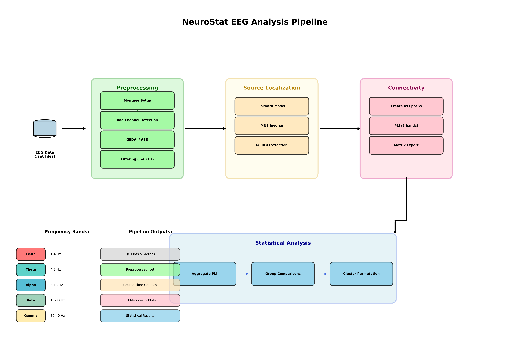
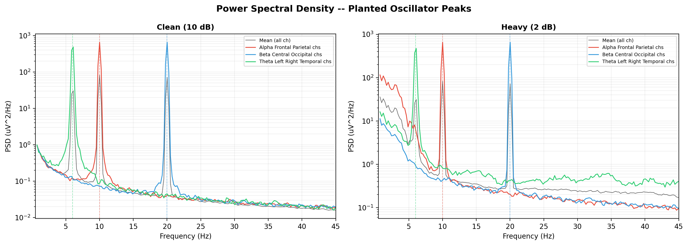

# Methods

## 2.1 Overview

NeuroStat is an open-source, end-to-end EEG processing pipeline that automates the transformation of raw EEGLAB recordings into source-localised phase lag index (PLI) connectivity matrices suitable for group-level statistical analysis in randomised controlled trials (RCTs). The pipeline was implemented in Python and built on MNE-Python (Gramfort et al., 2013). It accepted EEGLAB `.set` files as input and produced, for each recording, five band-specific PLI matrices at both sensor and source levels, together with preprocessing diagnostics and quality-control visualisations. Two preprocessing pathways were provided: a **Traditional** pathway combining Artifact Subspace Reconstruction (ASR; Mullen et al., 2015) with Independent Component Analysis (ICA) classified by ICLabel (Pion-Tonachini et al., 2019), and a **GEDAI** pathway employing Generalised Eigenvalue Decomposition-based Artifact Identification (Ros et al., 2025). Users may select either pathway depending on their data characteristics and research requirements. The pipeline was validated through two complementary strategies: an internal benchmark on simulated EEG with known ground-truth connectivity, and an external replication of a well-established neurophysiological effect using the PhysioNet EEG Motor Movement/Imagery Database (Schalk et al., 2004).



*Figure 1.* Schematic overview of the NeuroStat processing pipeline, illustrating the two preprocessing pathways (Traditional and GEDAI) converging on a common connectivity estimation and source localisation framework.

## 2.2 Preprocessing

All preprocessing was performed by the `preprocess_raw` function, which accepted a raw MNE object and a configuration dataclass specifying method-specific parameters. The preprocessing sequence proceeded through the following stages.

### 2.2.1 Electrode montage assignment

A hierarchical montage-matching algorithm was applied to ensure that channel positions were available for downstream spatial operations (interpolation, source localisation). The algorithm attempted, in order: BioSemi (64, 32, 128, 256), extended 10-05 (343 positions), standard 10-20, EasyCap M1, and EGI HydroCel montages. A montage was accepted when at least 80% of recording channels received three-dimensional positions. This design ensured compatibility with the major EEG acquisition systems used in clinical RCTs without requiring manual configuration.

### 2.2.2 Bad channel detection and interpolation

Channels exhibiting abnormal amplitude variance were identified using a z-score criterion. Per-channel variance was computed across the full recording, and channels whose variance exceeded 4.0 standard deviations from the mean were marked as bad and replaced using spherical spline interpolation (Perrin et al., 1989).

### 2.2.3 Artifact removal

Two mutually exclusive artifact removal strategies were implemented.

**GEDAI pathway.** The Generalised Eigenvalue Decomposition-based Artifact Identification method (Ros et al., 2025) was applied using the official `gedai` Python package (https://github.com/neurotuning/gedai). GEDAI identified artifact subspaces by solving a generalised eigenvalue problem in which a data covariance matrix was compared against a physics-informed reference covariance derived from a leadfield matrix. The reference covariance encoded the expected spatial patterns of neural sources, enabling principled separation of brain and non-brain components. The algorithm operated on 2.0-second windows with 50% overlap. Threshold selection was performed via grid search using the SENSAI (Signal and Noise Subspace Alignment Index) criterion, with a noise multiplier of 3.0 (balanced setting). A fallback hierarchy was implemented: if leadfield-based reference computation failed (e.g., due to non-standard channel nomenclature), the algorithm attempted identity-based and then data-driven reference covariance estimation. GEDAI was applied prior to temporal filtering to preserve broad-band artifact signatures.

**Traditional pathway.** Artifact Subspace Reconstruction (ASR) was applied as a first-pass non-stationary artifact reduction step. ASR identified a clean calibration segment from the recording, computed a robust estimate of the background EEG covariance, and reconstructed time windows whose principal-component structure deviated from the calibration beyond a cutoff threshold of 20 standard deviations (Mullen et al., 2015). The `asrpy` library was used as the primary implementation, with `meegkit` as an alternative backend.

### 2.2.4 Temporal filtering

A finite impulse response (FIR) bandpass filter (1--40 Hz, firwin design; Hamming window) was applied. Where configured, a notch filter was applied at the local mains frequency and its harmonics (e.g., 50 and 100 Hz for European data, 60 Hz for North American data). Notch frequencies exceeding the Nyquist limit were automatically excluded.

### 2.2.5 Re-referencing

Data were re-referenced to the common average.

### 2.2.6 Independent component analysis

ICA was fitted using the FastICA algorithm (Hyvarinen, 1999) with up to 25 components (or *n* -- 1, whichever was smaller, where *n* denoted the number of EEG channels). Epochs exceeding a 200 &mu;V peak-to-peak threshold were excluded from the ICA training data to prevent high-amplitude transients from biasing the decomposition. A fixed random seed (42) ensured reproducibility.

**Component classification.** When ICLabel was enabled (default in the Traditional pathway), each component was assigned a seven-class probability vector (brain, muscle, eye blink, heartbeat, line noise, channel noise, other) using the pre-trained ICLabel convolutional neural network (Pion-Tonachini et al., 2019). Components whose brain-class probability fell below a user-configurable threshold (default: 0.85) were excluded. When ICLabel was unavailable, a heuristic fallback identified ocular components via EOG correlation and muscular components via high-frequency power. Components identified as artifactual were projected out of the data using ICA subtraction.

### 2.2.7 Preprocessing output

The function returned the raw data both before and after preprocessing, the fitted ICA object, and a metadata dictionary documenting which steps were applied, the number of excluded ICA components, and any detected bad channels. These outputs supported downstream quality-control reporting and ensured full provenance tracking.

## 2.3 Connectivity estimation

### 2.3.1 Phase Lag Index

Functional connectivity was quantified using the Phase Lag Index (Stam et al., 2007), defined as:

> PLI(*i*, *j*) = |mean(sign(Im(S<sub>*ij*</sub>(*f*))))|

where S<sub>*ij*</sub>(*f*) denoted the cross-spectral density between signals *i* and *j* at frequency *f*, and Im denoted the imaginary part. PLI ranged from 0 (no consistent phase lead/lag) to 1 (perfectly consistent non-zero phase relationship) and was insensitive to volume-conducted, zero-lag artefacts that confound amplitude-based connectivity measures. PLI was computed using the `spectral_connectivity_epochs` function from MNE-Connectivity with adaptive multitaper spectral estimation (Slepian tapers), frequency-band averaging, and default settings for time-bandwidth product. The resulting connectivity matrices were symmetrised by taking the element-wise maximum of the matrix and its transpose, and the diagonal was set to zero. Five canonical frequency bands were analysed: delta (0.5--4 Hz), theta (4--8 Hz), alpha (8--13 Hz), beta (13--30 Hz), and gamma (30--45 Hz).

### 2.3.2 Sensor-level connectivity

For sensor-level analysis, preprocessed continuous data were segmented into fixed-length epochs (4.0 s with 50% overlap for simulated data; 2.0 s with 50% overlap for the shorter PhysioNet recordings). PLI was then computed for each frequency band, yielding an *n*<sub>ch</sub> &times; *n*<sub>ch</sub> connectivity matrix per band.

### 2.3.3 Source-level connectivity

Source-level analysis projected sensor data into anatomical source space using the following steps:

1. **Forward model.** A boundary element model (BEM) was constructed on the `fsaverage` template brain (Fischl, 2012) using a three-shell head model (conductivities: scalp = 0.3, skull = 0.006, brain = 0.3 S/m) with ico5 resolution (~10,000 source vertices per hemisphere).

2. **Noise covariance.** The noise covariance matrix was estimated from the preprocessed continuous recording using the Ledoit-Wolf shrinkage estimator (Ledoit & Wolf, 2004).

3. **Inverse solution.** The minimum-norm estimate (MNE; Hamalainen & Ilmoniemi, 1994) was applied with Tikhonov regularisation (&lambda;&sup2; = 1/9), depth weighting (exponent = 0.8), and orientation constraint set to the cortical surface normal.

4. **Region-of-interest extraction.** Source time courses were aggregated into 68 cortical regions defined by the Desikan-Killiany atlas (Desikan et al., 2006) using PCA-flip extraction (first principal component with sign-flip correction for temporal consistency).

5. **Connectivity.** Region time courses were segmented into non-overlapping 4.0-second epochs and submitted to PLI computation as described above, yielding a 68 &times; 68 connectivity matrix per frequency band.

## 2.4 Statistical analysis framework

NeuroStat provided built-in group-level statistical comparisons suitable for RCT designs. Edge-wise between-group differences were tested using Welch's *t*-test. To address the multiple-comparisons problem inherent in network-level inference, cluster-based permutation testing (Maris & Oostenveld, 2007) was implemented with 1,000 permutations and two-tailed testing (*p* < .05). An edge-based adjacency structure was defined such that two edges were considered neighbours if they shared a node.

## 2.5 Validation

### 2.5.1 Internal validation: Simulated EEG

To evaluate the pipeline's ability to recover known connectivity patterns under controlled conditions, simulated EEG data were generated with three planted cross-regional coupling patterns embedded in realistic background noise at four artifact severity levels.

**Signal generation.** Sixty-four-channel EEG was simulated at 250 Hz for 120 seconds using a BioSemi montage. Background activity was modelled as spectrally shaped (1/*f*) pink noise. Three oscillatory coupling patterns were superimposed using Kuramoto-style phase-coupled oscillators:

| Pattern | Band | Freq. (Hz) | Regions | Expected PLI | Phase lag |
|---------|------|-----------|---------|-------------|-----------|
| Frontal--parietal | Alpha | 10 | Fp1, AF7, AF3, F1 &harr; P1, P3, P5, P7 | 0.80 | &pi;/4 |
| Central--occipital | Beta | 20 | C1, C3, C2, C4 &harr; O1, Oz, O2 | 0.50 | &pi;/3 |
| Left--right temporal | Theta | 6 | C5, T7 &harr; C6, T8 | 0.30 | &pi;/6 |

Phase jitter was calibrated to achieve target PLI values: Brownian phase noise with standard deviation inversely scaled to coupling strength was added to the lagged region, producing realistic deviations from perfect phase locking. Oscillator amplitudes were set to 15 &mu;V with sinusoidal envelope modulation (0.1 Hz) to mimic the waxing and waning of neural oscillations.

**Artifact injection.** Four artifact severity conditions were defined (Table 1). Artifacts comprised: (a) Gaussian-shaped eye blink transients (~80--120 &mu;V, ~300 ms) applied to frontal channels with spatial falloff; (b) bandpass-filtered (20--100 Hz) electromyographic bursts (100--500 ms, 20--50 &mu;V) on temporal and peripheral channels; and (c) 50 Hz line noise with a 100 Hz harmonic and per-channel random phase. Background pink noise was scaled to achieve the target signal-to-noise ratio (SNR).

**Table 1.** Artifact severity levels for simulated EEG datasets.

| Condition | SNR (dB) | Blinks/min | EMG bursts/min | Line noise (&mu;V) |
|-----------|----------|-----------|----------------|-------------------|
| Clean | 10 | 0 | 0 | 0 |
| Light | 5 | 10 | 5 | 2 |
| Moderate | 5 | 30 | 15 | 5 |
| Heavy | 2 | 50 | 30 | 10 |

Each simulated dataset was saved in EEGLAB `.set` format alongside a machine-readable ground truth file (`ground_truth.json`) specifying the pattern definitions, channel assignments, and expected PLI values. A deterministic random seed (42) ensured full reproducibility.

**Batch processing.** All four datasets were processed through both preprocessing pathways (GEDAI and Traditional) using the full NeuroStat pipeline. Sensor-level PLI (64 &times; 64) was computed from 4.0-second overlapping epochs (50% overlap) across all five frequency bands. Source-level PLI (68 &times; 68 Desikan-Killiany regions) was computed via the source localisation procedure described in Section 2.3.3. Additionally, raw (unprocessed) sensor-level PLI was computed as a baseline reference, yielding a total of 80 PLI matrices (4 conditions &times; 2 methods &times; 5 bands &times; 2 levels).

**Metrics.** For each of the 12 condition--pattern combinations (4 artifact levels &times; 3 patterns), the recovered PLI was extracted by averaging the sensor-level PLI values between the two channel groups defining each planted pattern. Recovery accuracy was quantified using Pearson correlation (*r*), root mean squared error (RMSE), and mean absolute error (MAE) between expected and recovered PLI values. A head-to-head comparison tallied the number of cases in which each method produced a smaller absolute error.



*Figure 2.* Power spectral density of simulated EEG for the clean (left) and heavy-artifact (right) conditions. Coloured traces correspond to channels participating in each planted coupling pattern; dashed lines mark the target oscillatory frequencies (6, 10, and 20 Hz). The planted peaks were clearly visible in the clean condition and remained identifiable, though attenuated, under heavy artifact contamination.

### 2.5.2 External validation: PhysioNet EEGBCI

To demonstrate that the pipeline detected physiologically meaningful connectivity in independent, real-world EEG, an external validation was conducted using the PhysioNet EEG Motor Movement/Imagery Database (Goldberger et al., 2000; Schalk et al., 2004). This publicly available dataset contained 64-channel EEG sampled at 160 Hz from over 100 subjects performing motor and imagery tasks, with one-minute baseline recordings during eyes-open (Run 01) and eyes-closed (Run 02) resting states.

**Rationale.** A robust and well-replicated finding in the EEG literature is that posterior alpha-band (8--13 Hz) functional connectivity increases during eyes-closed relative to eyes-open resting state (Barry et al., 2007; Klimesch, 1999). This effect provided a clear, directional hypothesis against which to evaluate the pipeline.

**Subjects and data.** Twenty subjects (S001--S020) were included. For each subject, the eyes-open (EO) and eyes-closed (EC) baseline runs were downloaded via MNE-Python's EEGBCI utilities. Channel names were standardised using the MNE `eegbci.standardize` function, a `standard_1005` montage was applied, and data were re-referenced to the common average.

**Preprocessing.** Both EO and EC recordings were processed through the NeuroStat pipeline using the Traditional pathway with parameters adapted for the shorter recording duration: ICA was fitted with 15 components (reduced from the default 25 to accommodate the ~60-second recordings), and the ICLabel brain-probability threshold was relaxed to 0.50 (from 0.85) because ICLabel was trained on infomax ICA decompositions whereas FastICA was used here. ASR was disabled because the short recording duration precluded reliable calibration-segment estimation. All other parameters matched the standard pipeline configuration (bandpass 1--40 Hz, average reference, bad-channel z-score threshold of 4.0).

**Connectivity.** Alpha-band PLI was computed from 2.0-second overlapping epochs (50% overlap), yielding approximately 59 epochs per recording. Mean posterior PLI was defined as the average upper-triangle PLI value among 13 posterior channels (O1, Oz, O2, PO7, PO3, POz, PO4, PO8, P3, Pz, P4, P7, P8), selected to cover the occipital and parieto-occipital cortex where alpha generators are concentrated (Klimesch, 1999).

**Statistics.** The primary endpoint was the within-subject difference in mean posterior alpha PLI between EC and EO conditions. A two-tailed paired-samples *t*-test and a Wilcoxon signed-rank test were conducted. Effect size was quantified as paired-samples Cohen's *d* (mean difference divided by the standard deviation of difference scores). The significance threshold was set at &alpha; = .05.

### 2.5.3 Real-data method comparison

To compare the GEDAI and Traditional pathways on real EEG, a supplementary analysis applied both methods to the same 20 PhysioNet subjects and the same EC-versus-EO endpoint. Both pathways used identical base parameters (bandpass 1--40 Hz, 15 ICA components, 60 Hz notch, random seed 42). The Traditional pathway used ICLabel (threshold = 0.50) without ASR; the GEDAI pathway used leadfield-based GEDAI denoising (noise multiplier = 3.0) without ICLabel. Each method independently produced paired EO and EC posterior alpha PLI values, and the same paired *t*-test, Wilcoxon test, and Cohen's *d* statistics were computed. The method producing the larger expected-direction effect size (EC > EO) was identified as the better-performing pathway for this endpoint, with tied effect sizes resolved by the lower *p*-value and then by the larger number of subjects showing the expected direction.

## 2.6 Software and reproducibility

NeuroStat was implemented in Python 3 and depended on MNE-Python (Gramfort et al., 2013), MNE-Connectivity, MNE-ICLabel, SciPy, NumPy, Pandas, and Matplotlib. The GEDAI pathway required the official `gedai` package (https://github.com/neurotuning/gedai). The Traditional pathway required `asrpy` or `meegkit` for ASR. Optional GPU acceleration of PLI computation was available via CuPy. The complete validation suite could be reproduced from a single entry point:

```
python scripts/validation/run_complete_validation.py
python scripts/validation/physionet_validation.py
python scripts/validation/physionet_method_comparison.py
```

All random seeds were fixed, and ground truth specifications were stored in machine-readable JSON format. The source code, validation scripts, and sample outputs are available at https://github.com/ghani097/NeuroStat-for-RCTs.
