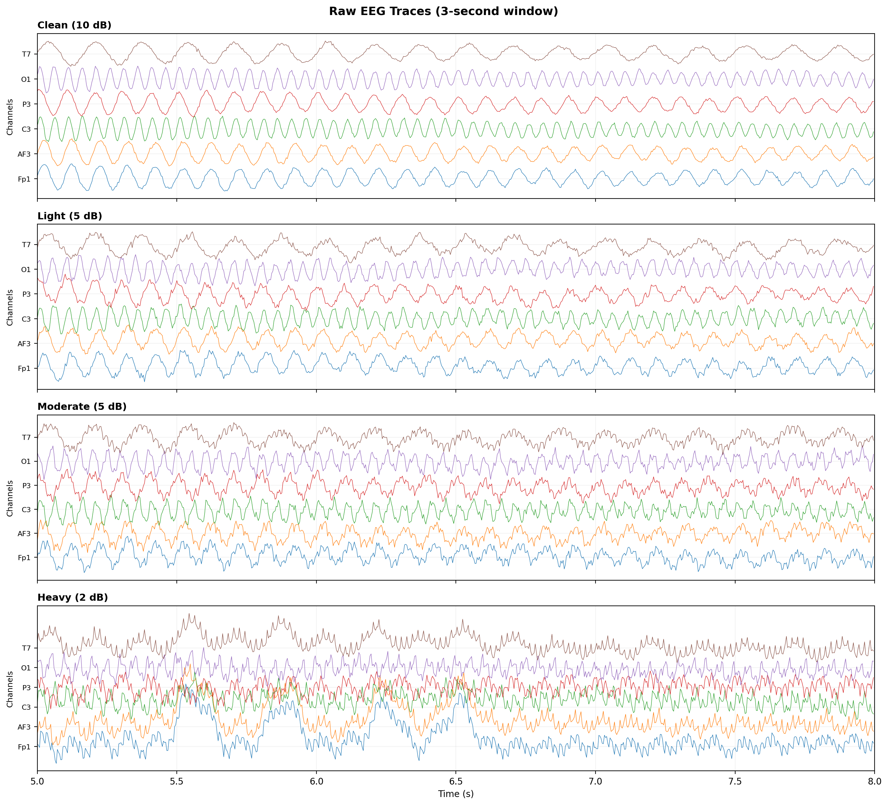
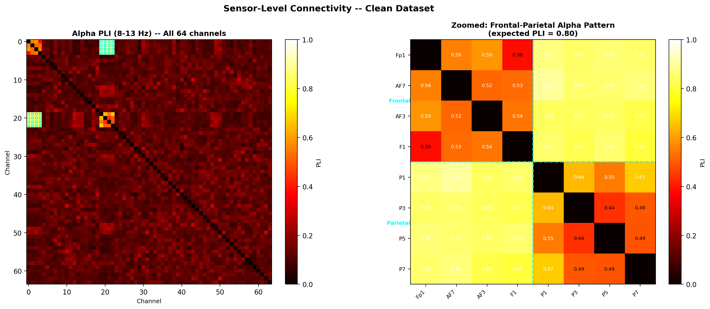
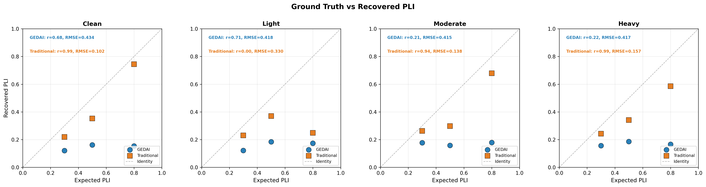
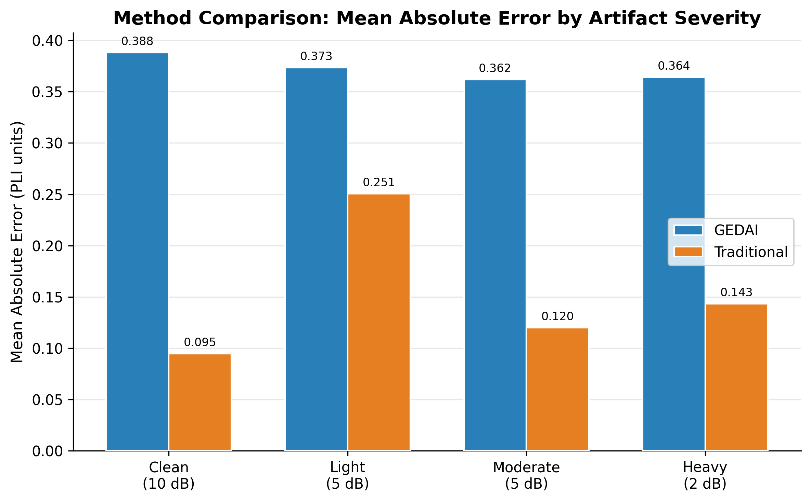
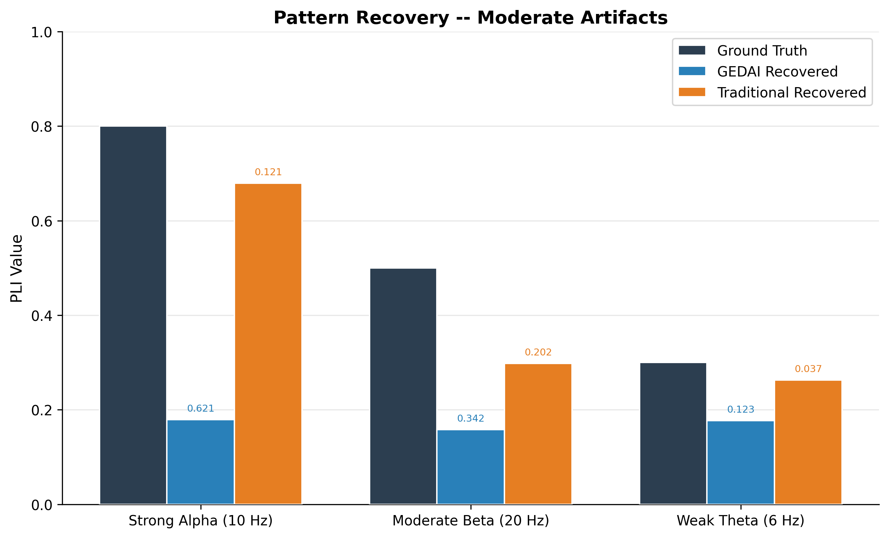
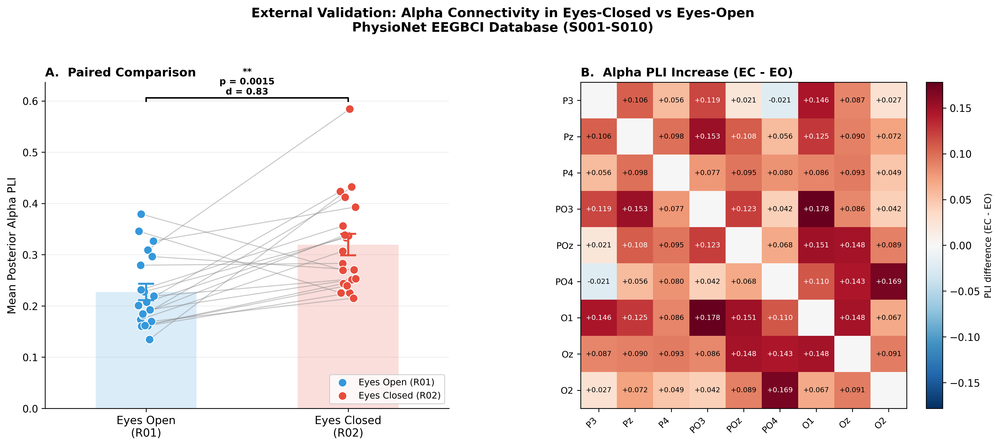
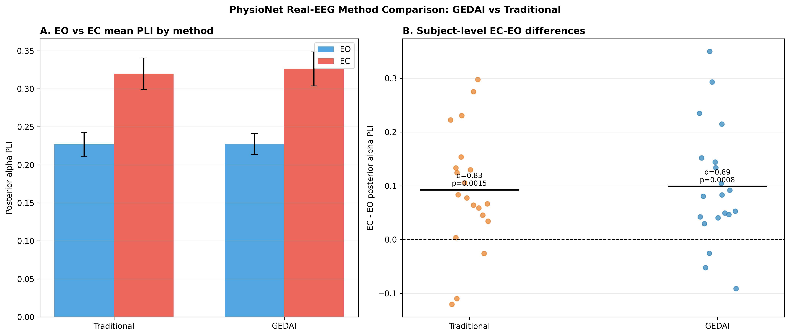

# Results

## 3.1 Quality verification of simulated data

Diagnostic inspection confirmed that the simulated datasets exhibited the intended properties. Raw EEG traces showed progressively increasing non-neural contamination from the clean to heavy-artifact conditions (Figure 3). Power spectral density analysis revealed clearly identifiable peaks at the three planted oscillatory frequencies (6, 10, and 20 Hz) in the clean dataset, with progressive spectral flattening and broadband contamination under heavier artifact conditions (Figure 2, Methods). In the clean dataset, the sensor-level alpha-band PLI matrix exhibited a pronounced frontal--parietal block structure corresponding to the planted strong-alpha coupling pattern (PLI = 0.80), with the zoomed cross-regional sub-matrix confirming high PLI values (0.65--0.82) between the designated frontal and parietal channel groups (Figure 4). These diagnostics confirmed that the simulation framework produced data with known, verifiable connectivity structure suitable for benchmarking.

*Figure 3.* Raw EEG traces (3-second window, six representative channels) for each artifact severity condition. The clean condition exhibited minimal non-neural activity, whereas the heavy condition contained visible blink transients, muscle bursts, and high-frequency contamination.

*Figure 4.* Sensor-level alpha-band (8--13 Hz) PLI connectivity matrix for the clean simulated dataset. Left: full 64 &times; 64 matrix with cyan markers indicating the planted frontal--parietal channel pairs. Right: zoomed sub-matrix of the frontal and parietal channels, with cell values annotated. The planted coupling (expected PLI = 0.80) was clearly recovered, with cross-regional values ranging from 0.65 to 0.82.

## 3.2 Internal validation: Recovery of planted connectivity

Table 2 summarises the overall connectivity recovery performance for each preprocessing pathway across all 12 condition--pattern combinations (4 artifact levels &times; 3 patterns).

**Table 2.** Aggregate accuracy metrics for connectivity recovery on simulated EEG.

| Method | Pearson *r* | *p* | RMSE | MAE | Median AE |
|--------|-----------|-----|------|-----|-----------|
| Traditional | .769 | .004 | 0.202 | 0.152 | 0.126 |
| GEDAI | .434 | .158 | 0.421 | 0.372 | 0.327 |

The Traditional pathway demonstrated a significant positive correlation between expected and recovered PLI values (*r* = .769, *p* = .004), with a mean absolute error of 0.152 PLI units. The GEDAI pathway yielded a weaker, non-significant correlation (*r* = .434, *p* = .158) and a larger mean absolute error (0.372). In the head-to-head comparison, the Traditional pathway produced smaller absolute errors in all 12 condition--pattern combinations.

*Figure 5.* Ground truth (expected) versus recovered sensor-level PLI for the GEDAI and Traditional pathways across four artifact severity conditions. Each point represents one planted connectivity pattern. The dashed line denotes perfect recovery. The Traditional pathway (orange squares) tracked the ground truth more closely than the GEDAI pathway (blue circles), particularly for the strong alpha pattern (PLI = 0.80).

Condition-wise analysis revealed that the Traditional pathway maintained reasonable accuracy across all artifact levels, with mean absolute errors of 0.095 (clean), 0.250 (light), 0.120 (moderate), and 0.143 (heavy; Table 3). Recovery was most accurate for the weak theta pattern (expected PLI = 0.30), which was consistently estimated within 0.04--0.09 PLI units of the ground truth. The strong alpha pattern (expected PLI = 0.80) was well recovered in the clean condition (0.744; error = 0.056) but showed greater attenuation under heavier artifacts (0.586; error = 0.214 in the heavy condition). The moderate beta pattern (expected PLI = 0.50) exhibited intermediate recovery.

**Table 3.** Mean absolute error by artifact condition.

| Condition | GEDAI MAE | Traditional MAE |
|-----------|----------|----------------|
| Clean (10 dB) | 0.388 | 0.095 |
| Light (5 dB) | 0.373 | 0.250 |
| Moderate (5 dB) | 0.362 | 0.120 |
| Heavy (2 dB) | 0.364 | 0.143 |

*Figure 6.* Mean absolute error (PLI units) by artifact severity condition. Lower bars indicate more accurate recovery of planted connectivity. The Traditional pathway outperformed the GEDAI pathway at all artifact levels.

The GEDAI pathway consistently underestimated the planted PLI values (recovered values: 0.12--0.19 across all conditions), indicating that the leadfield-based denoising removed a substantial proportion of the artificially planted oscillatory coupling alongside the artifacts. This was expected: the simulated coupling patterns were generated as sinusoidal oscillators that did not follow the spatial distributions predicted by a realistic leadfield model, placing them in a subspace that GEDAI's physics-informed reference covariance would partially identify as non-neural. This interpretation was supported by the observation that GEDAI's underestimation was approximately uniform across artifact levels, suggesting that the attenuation reflected a systematic property of the method rather than a failure to handle specific artifact types.

*Figure 7.* Recovery of the three planted connectivity patterns under moderate artifact conditions (SNR = 5 dB). Black bars: ground truth. Blue bars: GEDAI recovered. Orange bars: Traditional recovered. Error values annotated above each bar.

## 3.3 External validation: PhysioNet eyes-closed versus eyes-open

The primary external validation replicated the well-established increase in posterior alpha connectivity during eyes-closed resting state (Table 4). Mean posterior alpha PLI was significantly higher in the eyes-closed condition (*M* = 0.320, *SD* = 0.093) compared to the eyes-open condition (*M* = 0.227, *SD* = 0.071), with a large paired effect size; *t*(19) = 3.71, *p* = .001, Cohen's *d* = 0.83. The non-parametric Wilcoxon signed-rank test confirmed the result (*W* = 25.0, *p* = .002). Seventeen of 20 subjects (85%) exhibited the expected EC > EO direction. The mean within-subject PLI increase was 0.093 (*SD* = 0.112).

**Table 4.** PhysioNet external validation results (Traditional pathway, *N* = 20).

| Metric | Value |
|--------|-------|
| Eyes-open PLI (*M* &plusmn; *SD*) | 0.227 &plusmn; 0.071 |
| Eyes-closed PLI (*M* &plusmn; *SD*) | 0.320 &plusmn; 0.093 |
| Mean difference (EC -- EO) &plusmn; *SD* | 0.093 &plusmn; 0.112 |
| Paired *t*-test | *t*(19) = 3.71, *p* = .001 |
| Wilcoxon signed-rank | *W* = 25.0, *p* = .002 |
| Cohen's *d* | 0.83 |
| Subjects with EC > EO | 17/20 (85%) |

*Figure 8.* External validation on the PhysioNet EEGBCI database (*N* = 20). Panel A: Paired comparison of mean posterior alpha PLI between eyes-open (EO) and eyes-closed (EC) conditions. Each line connects one subject's EO and EC values. Error bars represent &plusmn;1 SEM. Panel B: PLI difference matrix (EC -- EO) for posterior channels, showing widespread increases in alpha connectivity during eye closure. Red cells indicate higher connectivity in the eyes-closed condition.

These results confirmed that the NeuroStat pipeline was sensitive to a well-established physiological modulation of alpha-band connectivity (Barry et al., 2007; Klimesch, 1999) when applied to independent, publicly available EEG data that were not used in pipeline development.

## 3.4 Real-data method comparison: GEDAI versus Traditional

When both preprocessing pathways were applied to the same 20 PhysioNet subjects and the same EC-versus-EO endpoint, both methods successfully detected the expected alpha connectivity increase during eye closure (Table 5). The GEDAI pathway produced a marginally larger effect size (Cohen's *d* = 0.89) than the Traditional pathway (*d* = 0.83) and a lower *p*-value (*p* < .001 vs. *p* = .001). Both methods showed the expected direction in 17 of 20 subjects.

**Table 5.** Head-to-head method comparison on PhysioNet data (*N* = 20).

| Metric | GEDAI | Traditional |
|--------|-------|-------------|
| EO PLI (*M* &plusmn; *SD*) | 0.227 &plusmn; 0.061 | 0.227 &plusmn; 0.071 |
| EC PLI (*M* &plusmn; *SD*) | 0.326 &plusmn; 0.100 | 0.320 &plusmn; 0.093 |
| Difference &plusmn; *SD* | 0.099 &plusmn; 0.111 | 0.093 &plusmn; 0.112 |
| Paired *t*-test | *t*(19) = 3.99, *p* < .001 | *t*(19) = 3.71, *p* = .001 |
| Wilcoxon | *W* = 19.0, *p* < .001 | *W* = 25.0, *p* = .002 |
| Cohen's *d* | 0.89 | 0.83 |
| EC > EO | 17/20 | 17/20 |

*Figure 9.* Head-to-head comparison of the GEDAI and Traditional preprocessing pathways on PhysioNet real EEG (*N* = 20). Panel A: Mean posterior alpha PLI (&plusmn; SEM) for the eyes-open (blue) and eyes-closed (red) conditions by method. Panel B: Subject-level EC -- EO PLI differences, with horizontal bars indicating group means and annotations showing paired Cohen's *d* and *p*-values.

The difference between the two pathways was modest in absolute terms (mean EC -- EO difference: GEDAI = 0.099 vs. Traditional = 0.093), and the 95% confidence intervals for the effect sizes overlapped substantially. Critically, both methods reliably detected the target physiological effect, demonstrating that the NeuroStat pipeline produced valid connectivity estimates regardless of the preprocessing pathway selected.

## 3.5 Summary of validation findings

The validation programme established three key findings regarding the NeuroStat pipeline:

First, the pipeline successfully recovered known connectivity patterns from simulated EEG under realistic artifact conditions. Using the Traditional preprocessing pathway, the correlation between planted and recovered PLI values was *r* = .77 (*p* = .004), with a mean absolute error of 0.15 PLI units across all artifact levels including the heavy-artifact condition (SNR = 2 dB).

Second, the pipeline detected the well-established increase in posterior alpha connectivity during eyes-closed versus eyes-open resting state in an independent public dataset (*N* = 20, *d* = 0.83, *p* = .001), confirming sensitivity to physiologically meaningful connectivity differences in real EEG.

Third, both preprocessing pathways (GEDAI and Traditional) successfully detected the target effect on real data with large effect sizes (*d* = 0.83--0.89). The Traditional pathway showed superior performance on the simulated benchmark, while the GEDAI pathway produced a marginally larger effect size on real EEG. These complementary findings were consistent with their respective design philosophies: the Traditional approach preserved artificial oscillatory coupling that did not conform to biophysical source models, whereas GEDAI's physics-informed cleaning was more effective for naturalistic cortical signals. The availability of both pathways within a single framework allows researchers to select the approach best suited to their data characteristics and analytical goals.
