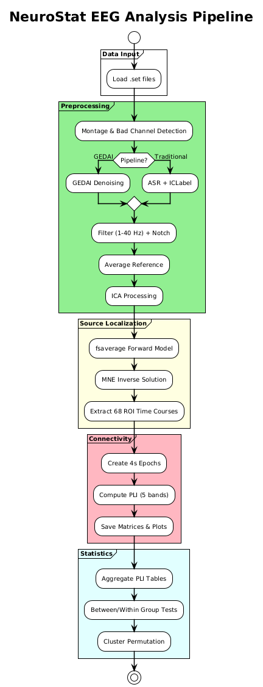
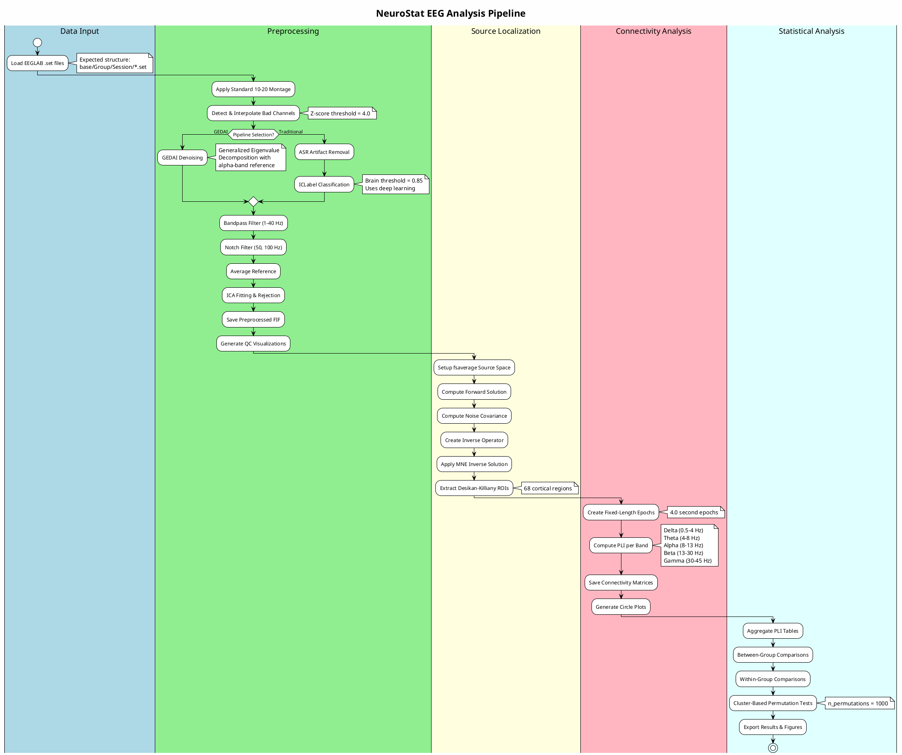
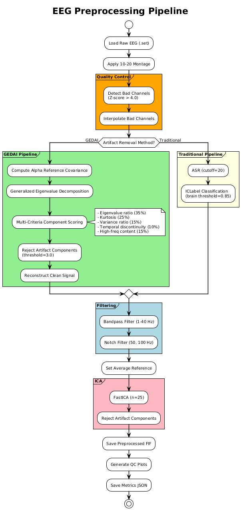
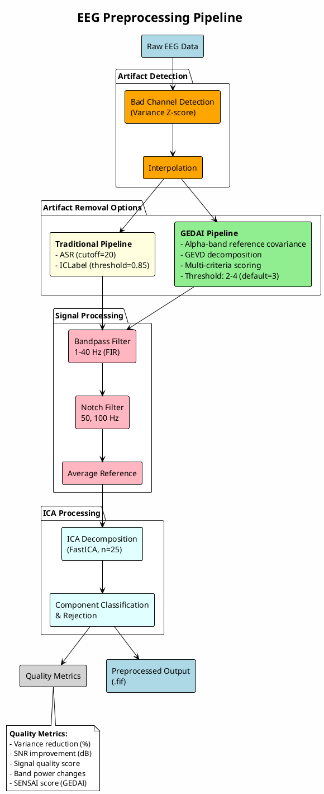

# Methods

## NeuroStat EEG Analysis Pipeline for Randomized Controlled Trials

### Overview

This document describes the comprehensive EEG preprocessing, source localization, functional connectivity analysis, and statistical testing pipeline implemented in NeuroStat. The pipeline is designed for analyzing multi-session, multi-group RCT data with standardized processing and rigorous statistical inference.

---

## 1. Pipeline Architecture

### 1.1 Complete Pipeline Diagram

**Rendered Diagram:**



<details>
<summary>PlantUML Source Code</summary>



</details>

### 1.2 Preprocessing Pipeline Diagram

**Rendered Diagram:**



<details>
<summary>PlantUML Source Code</summary>



</details>

---

## 2. Preprocessing Methods

### 2.1 Data Import and Channel Setup

**Methodology:** EEG data recorded in EEGLAB `.set` format are imported using MNE-Python's EEGLAB reader. A standard 10-20 montage is automatically applied to ensure consistent electrode positioning across subjects.

**Implementation:**
- Channel positions assigned via `make_standard_montage("standard_1020")`
- Missing or non-standard channels handled with warning logging
- Sampling frequency preserved from original recordings

### 2.2 Bad Channel Detection and Interpolation

**Methodology:** Channels with abnormal variance are automatically identified using a z-score approach and interpolated using spherical spline interpolation.

**Algorithm:**
1. Compute variance for each EEG channel
2. Calculate z-score: `z = (variance - mean) / std`
3. Mark channels with |z| > threshold (default: 4.0) as bad
4. Interpolate bad channels using neighboring electrode data

**Validation Metric:**
| Parameter | Default Value | Description |
|-----------|--------------|-------------|
| Z-score threshold | 4.0 | Channels exceeding this threshold are marked bad |
| Interpolation method | Spherical spline | MNE default method |

### 2.3 Artifact Removal - GEDAI Pipeline

**Methodology:** GEDAI (Generalized Eigenvalue De-Artifacting Instrument) uses Generalized Eigenvalue Decomposition (GEVD) to separate brain signals from artifacts based on spatial covariance patterns.

**Algorithm:**
1. **Reference Covariance:** Compute brain-like covariance from alpha-band (8-13 Hz) filtered data
2. **Data Covariance:** Compute full data covariance matrix
3. **GEVD:** Solve generalized eigenvalue problem: `data_cov @ W = ref_cov @ W @ D`
4. **Component Scoring:** Score each component using five criteria:
   - Eigenvalue ratio (35% weight) - brain-likeness measure
   - Kurtosis (25% weight) - non-Gaussianity indicator
   - Variance ratio (15% weight) - dominance measure
   - Temporal discontinuity (10% weight) - artifact spikiness
   - High-frequency content (15% weight) - muscle artifact indicator
5. **Artifact Rejection:** Remove components exceeding threshold (max 40% of components)
6. **Reconstruction:** Reconstruct clean signal using inverse projection

##### Parameters
| Parameter | Default | Range | Description |
|-----------|---------|-------|-------------|
| Threshold | 3.0 | 2.0-4.0 | Artifact rejection sensitivity |
| Max rejection | 40% | - | Maximum components removed |

**Quality Metrics:**
- **SENSAI Score:** Composite quality metric (0-100%) combining variance reduction, SNR improvement, and rejection ratio
- **Variance Removed:** Percentage of total signal variance attributed to artifacts
- **SNR Improvement:** Estimated signal-to-noise improvement in dB

### 2.4 Artifact Removal - Traditional Pipeline

**Methodology:** Combines Artifact Subspace Reconstruction (ASR) for transient artifact removal with ICLabel for ICA component classification.

#### 2.4.1 ASR (Artifact Subspace Reconstruction)
- Identifies high-variance time segments using principal component analysis
- Reconstructs contaminated segments using clean calibration data
- Cutoff parameter: 20 (standard deviations)

#### 2.4.2 ICLabel Classification
- Deep learning-based ICA component classification
- Classifies components into: Brain, Muscle, Eye, Heart, Line Noise, Channel Noise, Other
- Components with brain probability < threshold are rejected

**Parameters:**
| Parameter | Default | Description |
|-----------|---------|-------------|
| ASR cutoff | 20 | SD threshold for artifact detection |
| Brain threshold | 0.85 | Minimum probability to retain component |
| ICA method | FastICA | Decomposition algorithm |
| ICA components | Auto (25) | Number of components |

### 2.5 Spectral Filtering

**Methodology:** Frequency-domain filtering to isolate neural oscillations of interest.

**Parameters:**
| Filter Type | Frequency | Design |
|------------|-----------|--------|
| Bandpass | 1-40 Hz | FIR (firwin) |
| Notch | 50, 100 Hz | IIR notch |

**Rationale:**
- High-pass at 1 Hz removes slow drifts while preserving delta oscillations
- Low-pass at 40 Hz attenuates muscle artifacts while preserving gamma band
- Notch filters remove powerline interference

### 2.6 Reference Scheme

**Methodology:** Data are re-referenced to the average reference to improve source localization accuracy and reduce bias toward any single electrode.

---

## 3. Source Localization Methods

### 3.1 Source Space Setup

**Methodology:** Brain activity is localized to cortical sources using the fsaverage template brain and the Desikan-Killiany atlas parcellation.

**Parameters:**
| Parameter | Value | Description |
|-----------|-------|-------------|
| Subject | fsaverage | Template brain |
| Spacing | ico5 | Source space resolution |
| BEM model | 3-shell | Conductivity: 0.3, 0.006, 0.3 S/m |
| Atlas | Desikan-Killiany | 68 cortical regions |

### 3.2 Forward Solution

**Methodology:** The forward solution maps source activity to sensor space using a Boundary Element Method (BEM) model.

**Implementation:**
- Head model: 3-shell BEM (scalp, skull, brain)
- Minimum source-sensor distance: 5.0 mm
- EEG forward modeling enabled

### 3.3 Inverse Solution

**Methodology:** Minimum Norm Estimation (MNE) is used to estimate source activity from sensor-level recordings.

**Parameters:**
| Parameter | Value | Description |
|-----------|-------|-------------|
| Method | MNE | Minimum norm estimate |
| Lambda² | 1/9 | Regularization parameter |
| Orientation | Normal | Dipole orientation constraint |
| Depth weighting | 0.8 | Depth bias correction |
| Noise covariance | Shrunk | Estimation method |
| Loose | Auto | Orientation constraint |

### 3.4 ROI Time Course Extraction

**Methodology:** Source activity is summarized at the ROI level using PCA-flip for consistent sign across subjects.

**Output:** 68 time courses (one per Desikan-Killiany region)

---

## 4. Functional Connectivity Methods

### 4.1 Epoch Creation

**Methodology:** Continuous ROI time courses are segmented into fixed-length epochs for connectivity computation.

**Parameters:**
| Parameter | Value | Description |
|-----------|-------|-------------|
| Epoch length | 4.0 seconds | Duration per epoch |
| Overlap | None | Non-overlapping segments |

### 4.2 Phase Lag Index (PLI) Computation

**Methodology:** PLI quantifies phase synchronization while being robust to volume conduction artifacts.

**Definition:**
```
PLI = |<sign(sin(Δφ(t)))>|
```

where Δφ(t) is the instantaneous phase difference between two signals.

**Implementation:**
- Multitaper spectral estimation (adaptive)
- Frequency averaging within bands
- GPU acceleration available (CuPy)

### 4.3 Frequency Bands

| Band | Frequency Range | Neural Correlates |
|------|-----------------|-------------------|
| Delta | 0.5-4 Hz | Deep sleep, pathology |
| Theta | 4-8 Hz | Memory, navigation |
| Alpha | 8-13 Hz | Attention, inhibition |
| Beta | 13-30 Hz | Motor, cognitive control |
| Gamma | 30-45 Hz | Perception, binding |

### 4.4 Network Definitions

The following canonical brain networks are analyzed:

| Network | Regions (1-based indices) | Function |
|---------|---------------------------|----------|
| SN (Salience) | 1, 2, 19, 20 | Attention switching |
| DMN (Default Mode) | 15, 16, 21, 22, 29, 30, 31, 32, 35, 36, 47, 48, 51, 52, 53, 54 | Self-referential processing |
| CEN (Central Executive) | 5, 6, 55, 56, 57, 58, 59, 60 | Cognitive control |

---

## 5. Statistical Analysis Methods

### 5.1 Between-Group Comparisons

**Methodology:** Independent samples Welch's t-test comparing connectivity between treatment groups at each time point.

**Implementation:**
```python
t_stat, p_val = stats.ttest_ind(X, Y, equal_var=False)
```

**Output:** T-statistic and p-value matrices (68 x 68)

### 5.2 Within-Group Comparisons

**Methodology:** Paired comparisons examining connectivity changes across sessions within each group.

**Implementation:** Same as between-group but comparing time points within groups.

### 5.3 Cluster-Based Permutation Testing

**Methodology:** Multiple comparison correction using cluster-based permutation testing (Maris & Oostenveld, 2007).

**Parameters:**
| Parameter | Default | Description |
|-----------|---------|-------------|
| Permutations | 1000 | Number of permutations |
| Cluster threshold | Auto | T-value for cluster formation |
| Alpha | 0.05 | Significance level |

**Algorithm:**
1. Compute test statistic for each edge
2. Threshold to form clusters of connected edges
3. Sum t-values within clusters
4. Permute group labels and repeat
5. Compare observed cluster statistics to null distribution

### 5.4 Multiple Comparison Correction

- Edge-wise: FDR correction (Benjamini-Hochberg)
- Network-wise: Bonferroni correction for number of networks
- Cluster-based: Inherent correction via permutation distribution

---

## 6. Validation Metrics

### 6.1 Preprocessing Quality Metrics

| Metric | Description | Good Range |
|--------|-------------|------------|
| Variance Reduction | % variance removed by artifact rejection | 5-30% |
| SNR Improvement | Change in signal-to-noise ratio (dB) | > 0 dB |
| Signal Quality | Composite quality score | > 50% |
| SENSAI Score | GEDAI-specific quality metric | > 60% |
| ICA Components Rejected | Number of artifact components | 1-10 |
| Bad Channels | Channels interpolated | 0-5 |

### 6.2 Band Power Changes

Expected changes after preprocessing:
- **Delta:** Large reduction (artifact removal)
- **Theta:** Moderate reduction
- **Alpha:** Minimal change (preserved brain signal)
- **Beta:** Moderate reduction (muscle artifact removal)

---

## 7. Output Files

### 7.1 Per-Subject Outputs

| File | Description |
|------|-------------|
| `preprocessed_raw.fif` | Clean EEG data |
| `preprocessing_metrics.json` | Quality metrics |
| `traces_before_after.png` | EEG trace comparison |
| `psd_before_after.png` | Power spectrum comparison |
| `topomap_before_after.png` | Scalp topography comparison |
| `gfp_before_after.png` | Global field power comparison |
| `source_power.png` | ROI activation plot |
| `{band}_PLI.csv` | Connectivity matrix |
| `{band}_PLI.png` | Connectivity heatmap |
| `{band}_circle.png` | Circular connectivity plot |

### 7.2 Study-Level Outputs

| File | Description |
|------|-------------|
| `PLI_Table.xlsx` | Aggregated connectivity data |
| `stats/between_groups/` | Between-group statistical results |
| `stats/within_groups/` | Within-group statistical results |
| `stats/cluster_perm/` | Cluster permutation results |

---

## 8. Primary Visualizations

### 8.1 Preprocessing Quality Visualization

**Figure Reference:** `traces_before_after.png`

This visualization displays:
- Raw EEG traces before preprocessing (top panel, red)
- Cleaned EEG traces after preprocessing (bottom panel, green)
- Amplitude reduction statistics

### 8.2 Power Spectral Density Comparison

**Figure Reference:** `psd_before_after.png`

Shows:
- Mean PSD across channels before/after preprocessing
- Frequency band annotations (Delta, Theta, Alpha, Beta, Gamma)
- Power reduction visualization

### 8.3 Scalp Topography

**Figure Reference:** `topomap_before_after.png`

Displays:
- RMS amplitude topography before preprocessing
- RMS amplitude topography after preprocessing
- Noise reduction topography (difference)

### 8.4 Connectivity Circle Plot

**Figure Reference:** `alpha_circle.png`

Shows:
- Circular layout of 68 cortical regions
- Top connections visualized as colored lines
- Connection strength indicated by line color/thickness

---

## 9. References

1. Gramfort, A., et al. (2013). MEG and EEG data analysis with MNE-Python. Frontiers in Neuroscience, 7, 267.

2. Stam, C. J., et al. (2007). Phase lag index: Assessment of functional connectivity from multi channel EEG and MEG with diminished bias from common sources. Human Brain Mapping, 28(11), 1178-1193.

3. Maris, E., & Oostenveld, R. (2007). Nonparametric statistical testing of EEG-and MEG-data. Journal of Neuroscience Methods, 164(1), 177-190.

4. Desikan, R. S., et al. (2006). An automated labeling system for subdividing the human cerebral cortex on MRI scans into gyral based regions of interest. NeuroImage, 31(3), 968-980.

5. Chang, C. Y., et al. (2020). Evaluation of artifact subspace reconstruction for automatic artifact components removal in multi-channel EEG recordings. IEEE Transactions on Biomedical Engineering, 67(4), 1114-1121.

6. Pion-Tonachini, L., et al. (2019). ICLabel: An automated electroencephalographic independent component classifier, dataset, and website. NeuroImage, 198, 181-197.

---

## 10. Validation Tables

### Table 1: Preprocessing Validation Metrics (Example Subject)

| Metric | Value | Status |
|--------|-------|--------|
| Variance Reduction | 5.66% | Normal |
| SNR Improvement | -0.21 dB | Within range |
| Signal Quality | 21.34% | Low (GEDAI aggressive) |
| SENSAI Score | 21.34% | Low |
| ICA Components Rejected | 1/25 | Normal |
| Bad Channels | 1 (F5) | Normal |
| GEDAI Components Rejected | 2 | Normal |
| Delta Power Change | -97.65% | Expected (artifact removal) |
| Theta Power Change | -94.36% | Expected |
| Alpha Power Change | -77.61% | Moderate |
| Beta Power Change | -86.91% | Expected |

### Table 2: Pipeline Configuration Summary

| Stage | Parameter | Value |
|-------|-----------|-------|
| Preprocessing | Bandpass | 1-40 Hz |
| Preprocessing | Notch | 50, 100 Hz |
| Preprocessing | Reference | Average |
| Preprocessing | ICA Method | FastICA |
| Preprocessing | ICA Components | 25 (auto) |
| Artifact Removal | Method | GEDAI |
| Artifact Removal | Threshold | 3.0 |
| Source | Template | fsaverage |
| Source | Spacing | ico5 |
| Source | Method | MNE |
| Connectivity | Epoch Length | 4.0 s |
| Connectivity | Method | PLI |
| Statistics | Permutations | 1000 |
