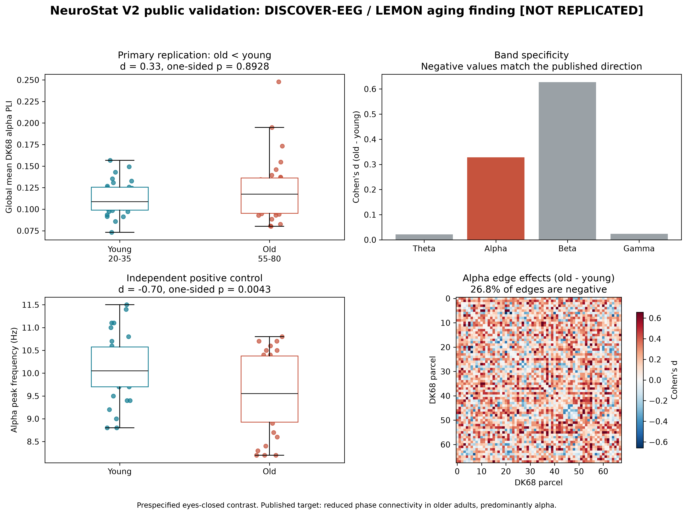

# LEMON / DISCOVER-EEG Replication

**Prespecified primary criterion: DID NOT PASS.** Older minus younger global alpha PLI was 0.009532 (Cohen's d = 0.328; one-sided permutation p = 0.892841). The effect was opposite to the frozen old-lower direction.

**Independent positive control: PASSED.** Older minus younger alpha peak frequency was -0.560 Hz (d = -0.704; one-sided permutation p = 0.004300).

The post-primary debiased-wPLI sensitivity also did not reproduce a global age decrease: older minus younger was 0.004660 (d = 0.140; one-sided p = 0.695193). This sensitivity does not replace the failed primary endpoint.

DISCOVER-EEG reported selected edgewise Bayesian effects rather than this frozen global-mean endpoint. This is a directional conceptual replication, not an exact numerical reproduction. Raw EEG and intermediate source artifacts are excluded from Git; the aggregate tables, figure, protocol, and hashes are included here.
