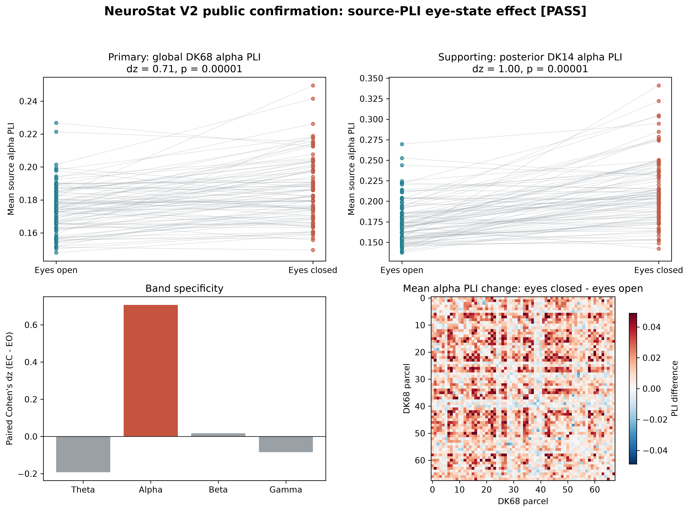

# PhysioNet Eye-State V2 Confirmation

**Independent primary criterion: PASSED.** In 89 participants, eyes-open mean global alpha PLI was 0.174734 and eyes-closed mean was 0.186256. The paired change was 0.011522 (dz = 0.706; one-sided 100,000-draw sign-flip p = 0.000010; 67/89 participants in the predicted direction).

This independently confirms the direction reported in DOI `10.1038/s41598-024-68532-2` using public PhysioNet EEGMMIDB v1.0.0 (DOI `10.13026/C28G6P`) and the actual NeuroStat V2 DK68 source-connectivity workflow. The published study's own recordings were not public, so this is an independent conceptual confirmation rather than an exact numerical reproduction. Raw EEG and intermediate artifacts are excluded from Git.
